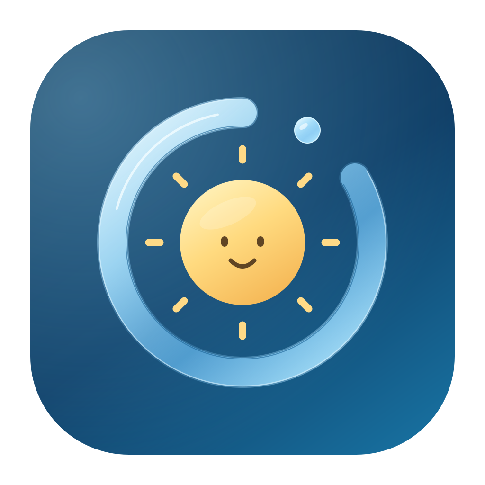

<p align="center"></p>

# Nokori

**[English](README.md) · [繁體中文](README.zh-Hant.md)**<br>
[简体中文](README.zh-CN.md) · [日本語](README.ja.md) · [한국어](README.ko.md) · [Русский](README.ru.md)

原生 macOS AI 用量监视器：中央小太阳宠物，可切换圆形或液态玻璃外观。

> 本项目是 [qunqin24 开发的 Pulse](https://github.com/qunqin24/Pulse) 的独立定制版，不代表原作者背书。本独立版本正式采用 **Nokori（原名 Pulse Pet）**。

## 定制功能

- **宠物浮点：** 保留圆形；宠物在收起和展开时都居中。
- **液态宠物：** 轮廓不规则、略微铺开；拖动产生滞后尾部，松手后回弹。只是表面张力与黏滞感的视觉近似，不是流体模拟。“减少动态效果”会禁用拉伸和回弹。
- **传统侧栏：** 保留原有的屏幕边缘面板。
- 指针靠近时展开账号圆环，停在圆环上显示原有详情卡片，离开面板和卡片后收起。
- 默认是持续活动的小太阳，也可选择猫、狐狸、兔子，或导入透明 PNG 并调整大小。
- 可选[天气宠物](Docs/weather-pet.md)：云朵、雨、雷雨、雪、雾与月亮。可离线固定选择造型，或启用当地天气并明确授权定位；拒绝或无法定位时可手选城市。Open-Meteo 免费服务仅限非商业用途。
- 保留服务商用量、账号、历史、菜单栏、通知和集成。[完整功能](Docs/features.md) · [支持服务](Docs/supported-services.md)。
- 保留 75%、80%、90%、95% 提醒选项，支持自行输入 **1～100%**。

## 安装与设置

**[下载试用 DMG — Apple Silicon＋Intel](Downloads/Nokori-1.12.6-weather-exclusive-58c8a96-trial-universal.dmg?raw=true)** · [SHA-256 与验证范围](Downloads/README.md)。文件直接保存在本仓库，不是正式稳定版或已标记的 GitHub Release；首次定位授权和成功设备定位仍待实测。上游 Pulse 安装包不包含本版功能。

1. 打开 DMG，把 **Nokori.app** 拖到“应用程序”，不要替换原版 **Pulse.app**。
2. 设置、应用数据、登录项和 URL scheme 独立，不迁移原版设置；上游自动更新已关闭。
3. 启动后选择要监控的服务。应用常驻菜单栏，也可右键点击面板打开设置。
4. 试用包仅临时签名，**未经 Apple 公证**。只对可信安装包使用“系统设置 → 隐私与安全性 → 仍要打开”。

需要 macOS 14+，完整 Liquid Glass 外观需要 macOS 26+。Universal 包包含 Apple Silicon 和 Intel；定制面板尚未在 Intel 硬件及旧版系统实测。

两款应用仍可能共用服务商账号、CLI 登录和系统钥匙串；独立数据不等于独立额度。Claude Code 的共用 status line 集成请只在其中一款启用。

- **设置 → 外观 → 面板样式：** 宠物浮点／液态宠物／传统侧栏。
- **设置 → 通用 → 界面语言：** 英语、繁体中文、简体中文、日语、韩语、俄语或跟随系统。页首链接只切换 README。
- **设置 → 通知：** 选择门槛或输入自定义百分比、应用并允许系统通知。提醒取决于实际读到的用量，不是连续实时监控。

> **从 Pulse Pet 升级：** 退出旧版、安装 Nokori，再移除旧 Pulse Pet 的应用本体，不要删除数据。保留原有独立设置与数据标识；不要同时运行新旧名称的同一应用。原版 Pulse 仍可与 Nokori 同时运行。[品牌与兼容性](Docs/branding.md)。

## 天气来源与费用

自动天气使用 **Open-Meteo，不读取 Apple“天气”App，也没有使用 WeatherKit**。功能默认关闭；启用且浮点面板可见时，约每 30 分钟刷新，不是实时同步。免费 API 不需要密钥，但**仅限非商业用途**，有请求量限制且不保证服务可用性。定位授权只提供位置，不授予读取“天气”App 的权限；目前不会消耗 WeatherKit 开发者的共用额度。[天气来源、费用与隐私详情（英文）](Docs/weather-pet.md#data-source-and-cost)。

## 从源码构建

需要完整 Xcode、macOS 26 或更新 SDK、Swift tools 6.0+ 和 Python 3；不可删除预览或仅使用 Command Line Tools。

```bash
git clone https://github.com/wenyen-hsu/Pulse.git Nokori
cd Nokori
swift build
TZ=UTC swift test
./Scripts/check-localization.sh
./Scripts/bundle.sh --zip
./Scripts/dmg.sh
```

产物为 `build.noindex/Nokori.app`、`Nokori-<version>.zip` 和 `Nokori-<version>.dmg`。本地打包不创建公开 Release。[工具链](Docs/build-from-source.md) · [打包说明](Docs/releasing.md)。

## 隐私、参与与授权

没有 Pulse 后端或 Pulse 账号；只连接已启用的服务商读取用量，凭证和本地记录留在 Mac。请先了解[服务商访问方式](Docs/providers/README.md)。不要公开 Token、Cookie、钥匙串或未遮蔽的日志。

定制版问题请到[本仓库 Issues](https://github.com/wenyen-hsu/Pulse/issues) 提交系统版本、架构、面板样式和重现步骤，不要要求上游作者支持。[贡献指南](CONTRIBUTING.md) · [安全回报](SECURITY.md) · [文档目录](Docs/README.md)。

感谢 **qunqin24 和 Pulse 贡献者**。保留 [Apache 2.0](LICENSE)、[NOTICE](NOTICE) 和[第三方声明](THIRD_PARTY_NOTICES.md)，安装界面与“关于”也保留致谢。Apache 2.0 允许按条款修改与再分发，但须保留必要授权和声明、标明修改并遵守第三方条款；不授予商标权或原作者背书。名称与 logo 的选用不代表已通过商标查核。

**[English](README.md) · [繁體中文](README.zh-Hant.md)**<br>
[简体中文](README.zh-CN.md) · [日本語](README.ja.md) · [한국어](README.ko.md) · [Русский](README.ru.md)
